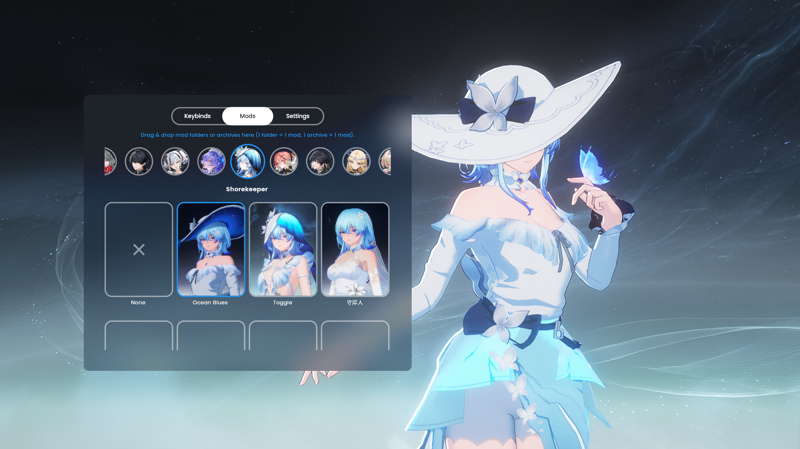
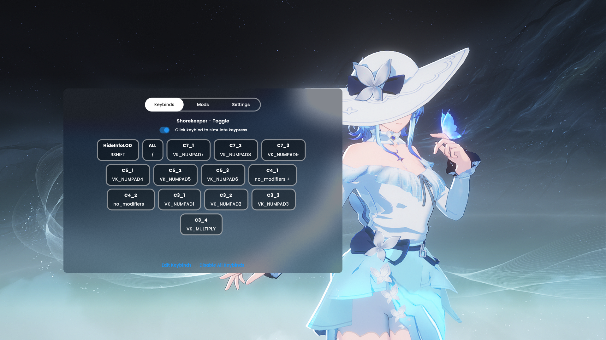
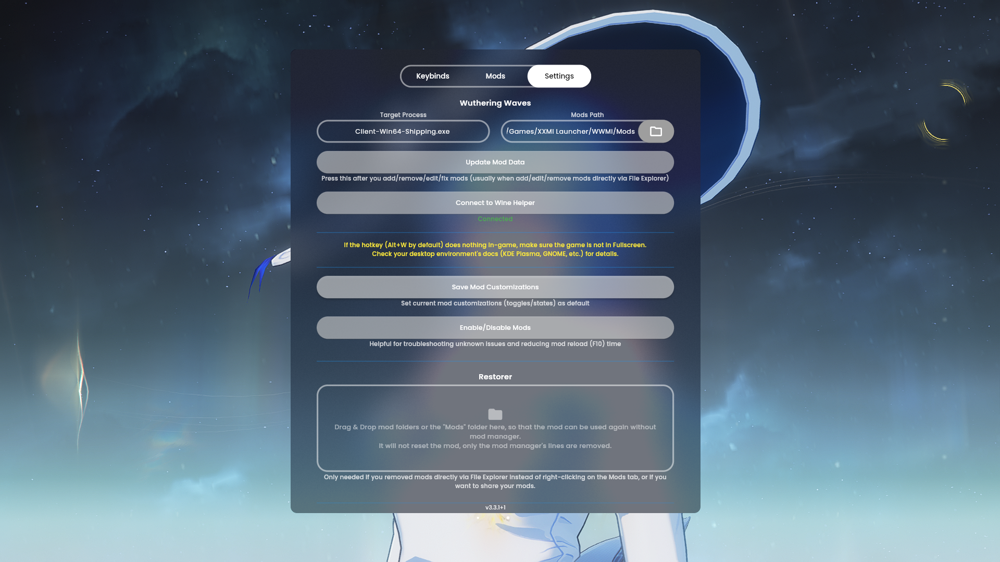
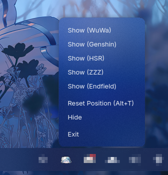

# No Reload Mod Manager

A mod organizer and switcher for games supported by [XXMI Launcher](https://github.com/SpectrumQT/XXMI-Launcher) and 3DMigoto. Switch mods in real-time without reloading the mods.

> **Note:** This tool **only manages mod files and folders**. It will also modify mod `.ini` files so it can be switched without reload ([see below](https://github.com/Aglglg/No-Reload-Mod-Manager#how-it-works)). It does **not** inject into the game process or load mods itself — that's handled by 3DMigoto or [XXMI Launcher](https://github.com/SpectrumQT/XXMI-Launcher). This app ships **empty** by default; no mods are included. You must source and install your own mods.

---

## Quick Start

1. **Download** the latest release for your platform:
   - **Windows**: installer `.exe` or portable `.zip`
   - **Linux**: `.AppImage`
2. **Run** the application and look for the icon in your system tray
3. Verify your **Mods Path** in Settings (auto-detect may target wrong path)
4. Click **Update Mod Data**
5. **Create a group** and **drag and drop** your mods, a single group is meant for a single character
6. Press **Alt+W** (default) in-game to open the manager

---

## Main Features
- Select and manage mods
- Edit keybinds and toggles
- Click UI buttons to trigger toggles (no keyboard needed)
- Supports keyboard, mouse, and XInput gamepads
- Saves your mod states and settings

## Extras
- Warns about missing libraries (RabbitFx, Orfix, Slotfix, etc.)
- Warns about duplicate libraries
- Adds icons to mods
- Helps organize mod folders
- More

---

## Preview
(These are taken on Linux, Windows may differs)

  
  
   
  
  
   
  

---

## Usage

### Opening the Mod Manager Window

- **System Tray**: Right-click the tray icon → select your game
- **In-Game Shortcut**: Press **Alt+W** (default). Works when the target game window is active. If nothing happens, verify:
  - The app is running (check system tray)
  - **Target Process** matches your game's executable in Settings
  - **Toggle Window Shortcuts** (Alt+W) is set correctly

### Auto-start with XXMI Launcher (Optional)

1. Right-click the Start menu entry → **Open File Location**
2. Right-click the shortcut → **Copy as path**
3. Open XXMI Launcher → Settings → Advanced
4. Enable **Run Pre-Launch** or **Run Post-Launch**
5. Paste the path

### Adding Groups and Mods

**Via UI:**
1. Go to the **Mods** tab
2. Right-click → **Add Group** (then optionally **Add Mod**)
3. Drag & drop mod folders into the group area (1 folder = 1 mod)
4. A single group is meant for one character
4. Click **Update Mod Data** to modify the `.ini` files

**Via File Explorer:**
1. Navigate to `Mods\_MANAGED_\`
2. Create a group folder named `group_1`, `group_2`, etc. (lowercase, sequential)
3. Place mod folders inside the group folder
4. Open Mod Manager window → click **Update Mod Data**

> **Limits:** 500 mods per group, 500 groups total.

### Removing Groups and Mods

**Via UI:**
1. Right-click a group or mod → **Remove Group/Mod**
2. The folder moves to `Mods\DISABLED_MANAGED_REMOVED\`
3. `.ini` files are restored (manager lines removed automatically)

**Via File Explorer:**
1. Move or delete the folder inside `Mods\_MANAGED_\`
2. Drag the folder to the **Restorer** area in Settings to remove manager lines
3. Click **Update Mod Data**

---

## How It Works

No Reload Mod Manager switches mods in real-time by patching `.ini` files that XXMI/3DMigoto reads at runtime.

### Mod File Modification
- Happens when you press **Update Mod Data**
- Only `.ini` files inside `_MANAGED_` are modified
- Changes are **minimal** — no new sections are added
- The manager adds `if-endif` blocks around [TextureOverride], [ShaderOverride], [ShaderRegex] main, [Present] sections and sets `$managed_slot_id` in the `[Constants]` section
- Duplicated namespaces across mods are automatically renamed to avoid conflicts
- Broken `if-elif-endif` structures detected by the XXMI/3DMigoto parser are commented out (prefixed with `;-;`)

### Update Mod Data Process

1. Reads the configured **Mods Path** and verifies `d3dx.ini` + `d3d11.dll` exist alongside it
2. Creates the `_MANAGED_` folder for managed mods
3. Generates helper files (`nrmm_keypress.txt`, `manager_group.ini`)
4. Scans all `group_x` folders for mods
5. Renames duplicate namespaces across mods
6. Parses each mod's `.ini` files against the XXMI/3DMigoto ruleset
7. Comments out Broken `if-elif-endif` lines, adds `$managed_slot_id` assignments, wraps command sections in `if-endif`
8. Creates backup of the original `.ini` files before modification, if not present yet
9. Displays a report of missing/duplicate libraries and issues
10. Saves via temp file (atomic write) to prevent corruption

> **Tip:** Use the **Restorer** in Settings to remove manager-added lines before distributing your mods or using the mods without mod manager.

### Keybinds Simulated

The manager simulates input for in-game mod switching:
- **VK_CLEAR**, **Space**, **Enter** keys
- **Mouse coordinates** (x, y) — determines group and mod index
- Any key defined by your mods' `.ini` files (when click-to-simulate is enabled)

---

## Technical Details

| Detail | Information |
|--------|-------------|
| **Framework** | Flutter (Dart) |
| **Target Games** | XXMI Launcher supported games + any 3DMigoto mod |
| **Window Detection** | Reads target game process name (e.g., `Client-Win64-Shipping.exe`) |
| **Ini Modifications** | `if-endif` blocks in Command List sections + `$managed_slot_id` in Constants |
| **File Safety** | Atomic writes via temp file + automatic `.ini` backup |

---

## Security

- Runs in the background with a system tray icon
- VirusTotal reports may falsely flag the installer
- Source code is available on GitHub — build it yourself for peace of mind

---

## Credits

Special thanks to:
- All bug reporters, contributors, testers, and users
- And especially our **supporters** ❤️

---

## Disclaimer

This is a mod organizer, not a mod loader. Use at your own risk — the developers are **not responsible** for account issues caused by mod usage. By downloading, you accept full responsibility.
